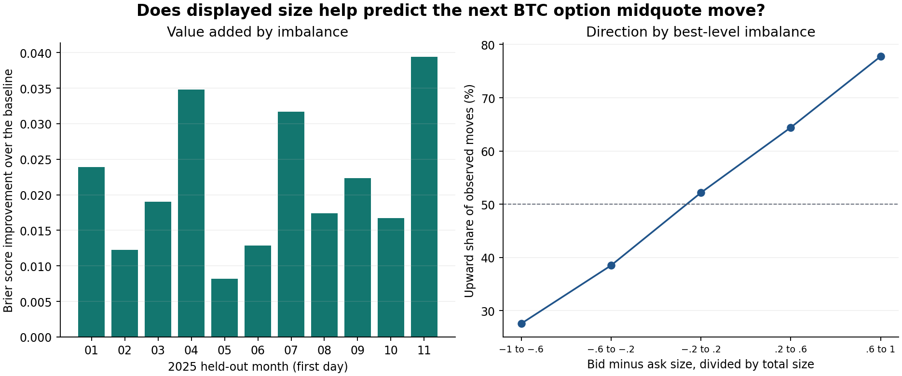
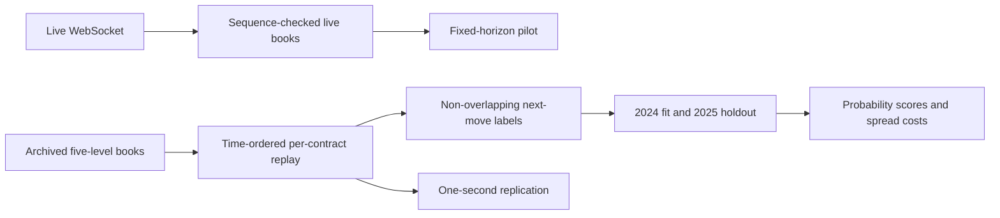
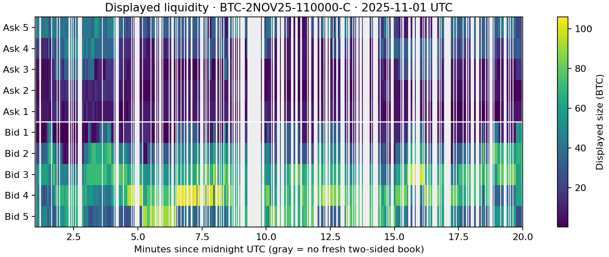

# Does order-book imbalance predict a BTC option's next price move?

On 158,484 held-out Deribit option midquote moves, predicting the side with more size at the best price got **65.18%** of directions right. Summing size across five levels got **56.06%**. Buying or selling at the displayed touch and reversing at the next move averaged **−0.994 entry spreads** for the best-level rule, before fees. A small midquote move can be predictable and still cost more to trade than it earns.

The study extends a live WebSocket recorder with a historical replay, an explicit forecast horizon, a chronological holdout and a ledger of every scored decision.

## What went into the sample

The archive contains **4,372,316 five-level snapshots** from 23 first-of-month windows, each covering 00:00–00:20 UTC. The 12 windows in 2024 supplied 274,655 training labels. The next 11 windows, January through November 2025, supplied 158,484 evaluation labels across 4,107 distinct BTC option contracts. The source transfer limit prevented retrieval of December 2025. November was the last available session before any holdout scores were inspected. The venue was Deribit throughout. [Tardis archive documentation](https://docs.tardis.dev/historical-data-details/deribit) · [Date manifest and checksums](data/replay/manifest.json)

At each qualifying book, the question is whether the next *distinct* option midquote moves up or down within ten seconds. Each contract can have one outstanding prediction. Size, spread and the previous move use only updates received by decision time. Equal receipt timestamps collapse to one observable state. Invalid books interrupt a trial, and each new session starts fresh. The first minute is warm-up. New trials stop ten seconds before session end.

Of 429,880 held-out decisions, 158,484 had an observed move within the horizon (36.87%). Another 262,090 timed out, 5,025 hit an invalid book and 4,281 had no later eligible observation before their stream ended. Accuracy is conditional on the observable moves. [Evaluation protocol](research/archive/PROTOCOL.md) · [Full results](results/replay/summary.json)

## Results

| Direction rule or model | Held-out accuracy | Brier score ↓ |
|---|---:|---:|
| Training majority | 52.34% | 0.2498 |
| Sign of five-level imbalance | 56.06% | — |
| Sign of best-level imbalance | **65.18%** | — |
| Logistic model using last move, relative spread and call/put | 61.46% | 0.2354 |
| Same model with best-level and five-level imbalance | 63.24% | **0.2155** |
| Supplementary baseline including recent moves in other BTC options | 61.64% | 0.2286 |
| Same supplementary baseline with imbalance | 65.20% | **0.2095** |

The fixed rules break equal-size ties using the training majority. The Brier score is mean squared error of the predicted probability. On the prespecified comparison, adding depth reduced Brier score by **0.01992**. It improved in all 11 test sessions, with a paired whole-session bootstrap interval of **0.01660–0.02451**. Giving each session equal weight produced an improvement of 0.02168. The supplementary model uses votes from other contracts in the previous complete second, reversing put directions and excluding the target contract. Its incremental Brier improvement was **0.01910**. [Peer control](research/archive/PEER_CONTROL.md) · [Peer results](results/replay/peer-control.json)



**What a trader could capture.** For each scored move, take the direction of the best-level size signal. The mean signed mid-to-mid move was **+0.066 entry spreads**. Crossing the ask to enter a long and the bid to exit, or the reverse for a short, yielded **−0.994 entry spreads** on average. This diagnostic assumes an immediate small fill at each displayed touch, excludes fees and latency, and is conditional on seeing a move. It does not establish a passive fill rate or a strategy return.

**Connection to the original live study.** The live pilot's five-level sign rule got 2 of 7 held-out one-second directions right. Replaying its one-second sampling rule over the archive gave **25,250 correct out of 43,332 scored moves (58.27%)**, versus **51.01%** for the training-majority baseline. That count excludes unchanged mids, zero imbalance and missing timely quotes. It uses a different prediction target from the headline next-move study. [Live pilot](docs/live-pilot.md) · [Fixed-horizon counts](results/replay/summary.json)

## How to reproduce it

From the project root on a laptop with Python 3.10, install the recorded dependencies and run the study. The local workspace includes all 23 data slices. The offline command verifies every checksum, runs the tests, rebuilds both comparisons, audits the decision ledger, and regenerates the figures.

```sh
python3 -m venv .venv
. .venv/bin/activate
python3 -m pip install -r research/archive/requirements.txt
sh research/archive/reproduce.sh --offline
```

For a fresh copy without the cached data, run `sh research/archive/reproduce.sh` once with network access. It streams the beginning of each public archive and retains the BTC option rows. Each date is pinned by URL and the SHA-256 digest of its extracted CSV. The raw data and per-decision ledger are local files. The aggregate results, scripts, input manifest and charts are included in version control. [Fetcher](research/archive/fetch.py) · [Offline audit](research/archive/audit.py)





The heatmap uses the contract with the most updates during the one-minute warm-up in the final session. Each column shows the latest available sizes at that time. Gray indicates a missing or stale two-sided book. The forecast study uses all eligible contracts.

## Interpretation and limitations

- The sample covers 7 hours 40 minutes spread over 23 calendar dates, all at the same UTC time. August 2025 supplies 43,269 of the 158,484 evaluation moves. The per-session comparison helps show whether that large session drove the result.
- Many contracts move together. The uncertainty interval resamples entire dates and has only 11 held-out dates to work with. The peer control measures common option repricing and does not observe the underlying futures book directly.
- The historical records are normalized book snapshots. Sequence-gap detection applies to the separate live WebSocket recorder. This replay evaluates archived observable quote states, with a two-second freshness filter.
- The model predicts direction given a move. The sign rule is competitive with the fitted models. No fill or exchange order was submitted. [Interview notes](INTERVIEW_NOTES.md)
