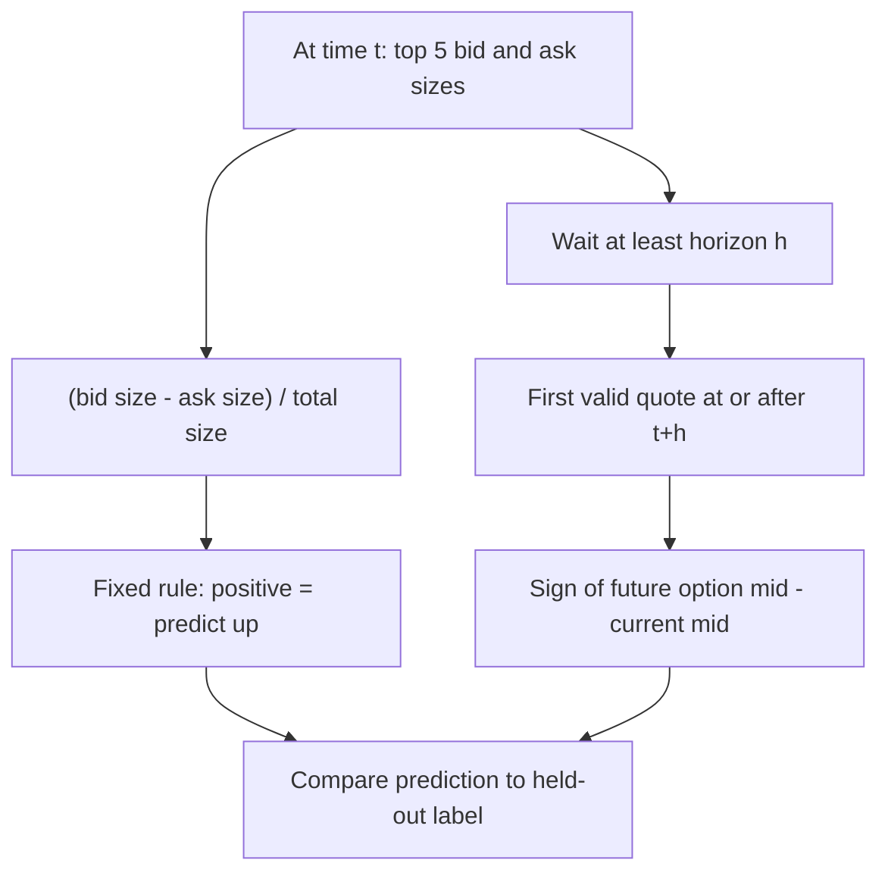
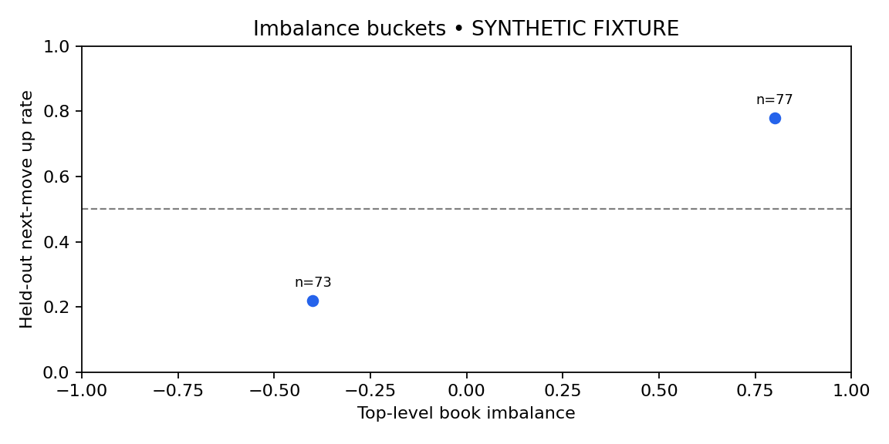
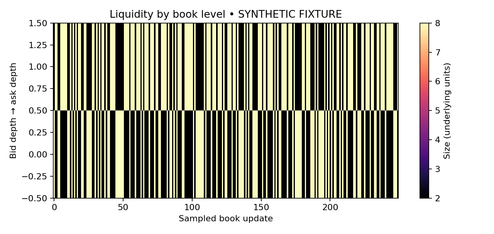

# Options Book Imbalance

> Can a lopsided options order book tell me which way the *option's own midquote* moves next?

I built a recorder for Deribit's public BTC/ETH option-book WebSocket and a small event study around that question. The recorder saves raw messages, reconstructs the book, rejects sequence gaps, and keeps analysis separate from collection. I can replay a capture exactly. **The first live pilot did not show a positive predictive result.** The bundled demo is generated data with a known built-in relationship, useful for checking that the pipeline can recover one.

Portfolio project documenting a public options-book capture and its early evaluation.

## TL;DR

- The saved **synthetic fixture** has 501 book updates, seed 7. A fixed sign-of-imbalance rule gets **117/150 (78%)** next-move directions on the chronological holdout versus **49.3%** for the training-set majority-class baseline. The generator deliberately makes imbalance predictive; this is a pipeline check, **not market evidence**.
- The collector uses Deribit's public `book.{instrument_name}.100ms` channel. It records snapshots and deltas, checks `prev_change_id`, and reconnects after a gap. Deribit documents the [public options book channels](https://docs.deribit.com/articles/options-data-collection-best-practices) and [sequence handling](https://docs.deribit.com/articles/notifications).
- The evaluator samples decision times at least one horizon apart, uses the first quote at or after each horizon, refuses labels across a resubscription, and holds out the last 30% of labeled observations.
- I also checked a **180-second live BTC option capture** on 24 November 2026: 339 book messages, one snapshot, no detected gaps, but only 17 nonzero, timely one-second labels. The evaluator returned `insufficient_data`; there is no live accuracy claim.
- A longer capture of the same option produced **911 valid book observations** over roughly 15 minutes in two segments. The one-second study had 23 usable labels; the fixed rule got **2/7** held-out directions right versus **4/7** for the training-majority baseline. A separately announced 10-second check also got **2/7 versus 4/7**. Seven holdout moves are too few for a reliable inference.

## Architecture

```mermaid
flowchart LR
  A["Deribit public options book<br/>100 ms WebSocket"] --> B["JSONL raw recorder"]
  B --> C["Snapshot + incremental<br/>book reconstruction"]
  C --> D["Sequence gap and crossed-book checks"]
  D --> E["Top-N bid/ask size imbalance"]
  E --> F["Causal future-mid labels"]
  F --> G["Chronological 70/30 evaluation"]
  G --> H["Saved JSON results"]
  H --> I["Liquidity heatmap + outcome chart"]
```



## Mechanism I am testing



I chose **option midquote direction** as the first outcome because it is observable from the same book. The rule does not tune a threshold on the holdout. I drop unchanged mids from the direction score and report their exclusion through the label count. The baseline predicts whichever move direction is most common in the training period. Equal-width imbalance buckets show whether the relationship is monotone rather than just giving one accuracy number.

The liquidity heatmap shows top bid levels below top ask levels over sampled updates. It is a view of **displayed** liquidity, not an estimate of hidden orders or executable fill size.

## Results

The bundled reproducible result is [`results/demo_synthetic.json`](../results/demo_synthetic.json), produced from [`data/demo_synthetic.jsonl`](../data/demo_synthetic.jsonl). The generator uses one bid and one ask level. At each step it makes the next mid move agree with the current imbalance sign 75% of the time. The observed 78% holdout accuracy is therefore unsurprising. The exact holdout interval and Wilson interval are in the JSON file.





**What the numbers do not show:** reliable predictive power in real options, profits, fill probability, latency advantage, robustness across strikes/expiries, or after-spread/fee performance. A quote can move without a trade; an option mid can move because the underlying or implied volatility moves; thin books can be easily skewed or stale. A useful live study would need more time, multiple instruments and market regimes, and controls for spread, liquidity, underlying moves, and overlapping tests. This first version tests only the sign of the next option-mid move.

**Short live validation:** I captured `BTC-4DEC26-64000-C` through the public channel for 180 seconds. It produced 339 messages (one snapshot and 338 changes), no sequence gaps or invalid books. At a predeclared 1-second horizon with 1-second tolerance, 129 decision times produced 17 nonzero labels; 102 were zero mid moves, nine had no timely future quote, and one reached the end of the capture. Seventeen is below the minimum of 20 labels for even a descriptive holdout score. The local capture and analysis stay out of the published repository; this paragraph is a validation summary, not a predictive result.

**Longer live pilot:** A subsequent capture of the same option ran for roughly 15 minutes on 24 November 2026. The WebSocket closed after about ten minutes; I fixed empty-frame handling and resumed by appending a fresh snapshot. The final file contains 911 book messages, two snapshots, and no sequence mismatches or invalid books within either segment. At the original one-second horizon with one-second tolerance, 482 sampled decision times yielded 23 nonzero timely labels: 335 had an unchanged mid, 122 lacked a timely future quote, one crossed the reset, and one reached the file end. The 70/30 chronological split left **16 training and seven test labels**. The sign rule got **2/7 (28.6%)** right; the training-majority baseline got **4/7 (57.1%)**. All seven test imbalances were between -0.2 and 0.2, so this sign-only rule was acting on small differences in displayed size. A 10-second horizon with 10-second tolerance, announced before inspecting the final accuracy, had 21 labels and the same 2/7 versus 4/7 holdout result. The one-second Wilson interval is 8.2–64.1% under an independence assumption; serial dependence makes even that interval optimistic. This is an inconclusive small-sample pilot with no evidence of an edge. The raw live captures and full local result JSONs are excluded from the repository; the synthetic fixture remains fully reproducible.

## Run it yourself

Python 3.10+ on a laptop. The live collector uses `websocket-client`; chart creation uses Matplotlib. No API key or trading account is needed for the public 100 ms channel.

```bash
python3 -m venv .venv
.venv/bin/python -m pip install -e '.[charts]'

# See liquid active options; choose one with a two-sided book.
.venv/bin/options-book discover --currency BTC --limit 10

# Record a live option; insert a current instrument_name from discover.
.venv/bin/options-book collect --instrument BTC-<expiry>-<strike>-C \
  --seconds 3600 --output data/live-btc-option.jsonl

# If a capture is interrupted, append a new snapshot segment safely.
.venv/bin/options-book collect --instrument BTC-<expiry>-<strike>-C \
  --seconds 600 --output data/live-btc-option.jsonl --append

# Evaluate a saved capture. If there are too few labeled moves, collect longer.
.venv/bin/options-book analyze --input data/live-btc-option.jsonl \
  --output results/live-btc-option.json --horizon-ms 1000 --tolerance-ms 1000
.venv/bin/python scripts/make_figures.py --input results/live-btc-option.json \
  --output-dir docs/img/live
```

The example instrument is a placeholder, not a currently listed contract. Deribit changes available strikes and expiries. The `discover` command makes one `get_instruments` call and one chain-summary call; it does not poll. The collector records only public book data. Its local clock decides capture duration; event labels use exchange timestamps. For this initial study, analyze each capture separately rather than pretending disconnected sessions form one continuous book.

Offline demonstration:

```bash
PYTHONPATH=src python3 -m options_book_imbalance.cli fixture \
  --output data/demo_synthetic.jsonl --seed 7
PYTHONPATH=src python3 -m options_book_imbalance.cli analyze \
  --input data/demo_synthetic.jsonl --output results/demo_synthetic.json \
  --horizon-ms 100 --tolerance-ms 0
python3 scripts/make_figures.py --input results/demo_synthetic.json --output-dir docs/img
```

`scripts/make_figures.py` reads the saved results JSON only. It never generates its own observations or inserts hand-picked chart values. The results file records the source metadata, seed, command, Python version, elapsed analysis time, repetition count, and load average.

## Tests

```bash
PYTHONPATH=src python3 -m unittest discover -s tests -v
```

The tests exercise snapshot/change/delete reconstruction, a sequence gap and fresh snapshot, no cross-gap or early future labels, and the deterministic end-to-end fixture. I ran these locally: **3 tests passed**.

## What this isn't

This is not a trading strategy, execution simulator, or proof that book imbalance predicts real options prices. It contains no exchange credentials, order entry, broker connection, or live P&L. The bundled demo data are synthetic. The live pilot is too small for a predictive-performance claim, and the fixed rule underperformed its baseline on the seven held-out moves.
